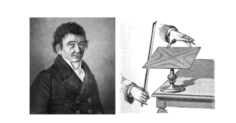
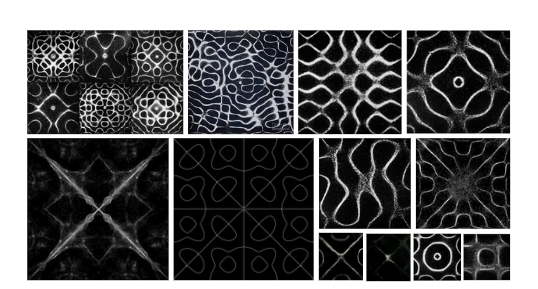

# Padrões de Chladni

**Conceito**
Em 1787, Ernst Chladni espalhou areia sobre uma placa metálica e fê-la vibrar com um arco de violino. A areia fugiu das zonas que vibram e acumulou-se nas linhas nodais, as zonas onde a placa quase não se mexe, formando figuras geométricas simétricas.

Este projeto simula esse fenómeno. Cada padrão é determinado por dois números, m e n, e o utilizador pode ver os valores que deram origem à figura que está no ecrã.

# MoodBoard
