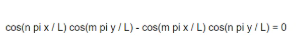

# Padrões de Chladni

**Conceito**
Em 1787, Ernst Chladni espalhou areia sobre uma placa metálica e fê-la vibrar com um arco de violino. A areia fugiu das zonas que vibram e acumulou-se nas linhas nodais, as zonas onde a placa quase não se mexe, formando figuras geométricas simétricas.

Este projeto simula esse fenómeno. Cada padrão é determinado por dois números, m e n, e o utilizador pode ver os valores que deram origem à figura que está no ecrã.

**MoodBoard**

Input + Expressão = Artefacto

**Input** - random() (sorteio de m e n) e clique do rato
**Referência / Expressão** - Fórmula física das placas de Chladni, representada por um sistema de partículas
**Output** - Visualização interativa em que as partículas se reorganizam em cada novo padrão, com os valores de m e n visíveis

## Como funciona
 A função que descreve a vibração de uma placa quadrada é:
 

 - Onde **f(x, y)** é próximo de 0, a placa não vibra: são as linhas nodais, onde as partículas se acumulam.
 - Onde **|f(x, y)|** é grande, a placa vibra muito e as partículas são empurradas para fora.
 - **m e n** definem o padrão. Se m = n, a função dá sempre 0 e a placa fica vazia, por isso essa combinação é excluída.
 - Trocar m por n dá a mesma figura (só muda o sinal), por isso os valores são apresentados sempre com m > n.

 **Interação**
**Clique do rato:** sorteia novos valores de m e n (entre 1 e 6) e dá um impulso aleatório a todas as partículas, que se reorganizam no novo padrão.
Os valores atuais de m e n aparecem no centro, na parte de baixo do ecrã.

## Uso de AI

Foi usado o **Claude (Anthropic)** como ferramenta de apoio, de forma transparente e acompanhada. O resultado final está escrito em p5.js.

**Assistido por AI:**
Explicação do código: o Claude descreveu como funciona a fórmula e a estrutura do sketch, o que me ajudou a compreendê-lo.

**Correções em randomPatterns():**
- uso de maxMN + 1, para que o valor máximo (6) também possa ser sorteado, já que floor(random(1, 6)) só dava 1 a 5.
- ciclo do...while, para garantir que m e n nunca saem iguais.
- troca para ficar sempre m > n, como na tabela de referência.

**Assistido por AI:**
- **Explicação do código:** o Claude descreveu como funciona a fórmula e a estrutura do sketch, o que me ajudou a compreendê-lo.
- **Correções em randomPatterns():**
uso de maxMN + 1, para que o valor máximo (6) também possa ser sorteado, já que floor(random(1, 6)) só dava 1 a 5;
- ciclo do...while, para garantir que m e n nunca saem iguais;
- troca para ficar sempre m > n, como na tabela de referência.
Apresentação dos valores no ecrã: código para mostrar m e n, e o posicionamento centrado em baixo com textAlign().
